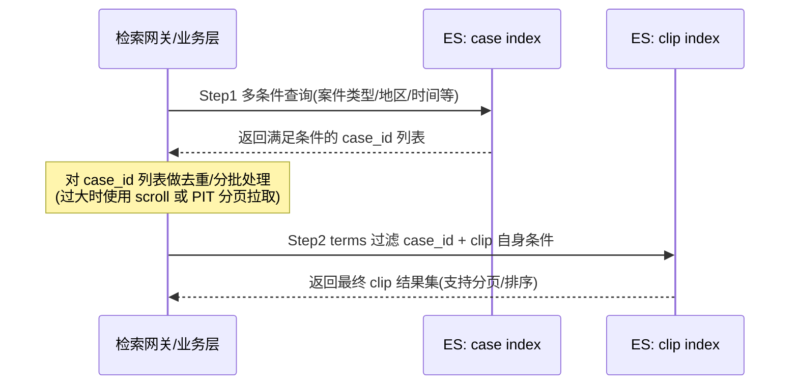
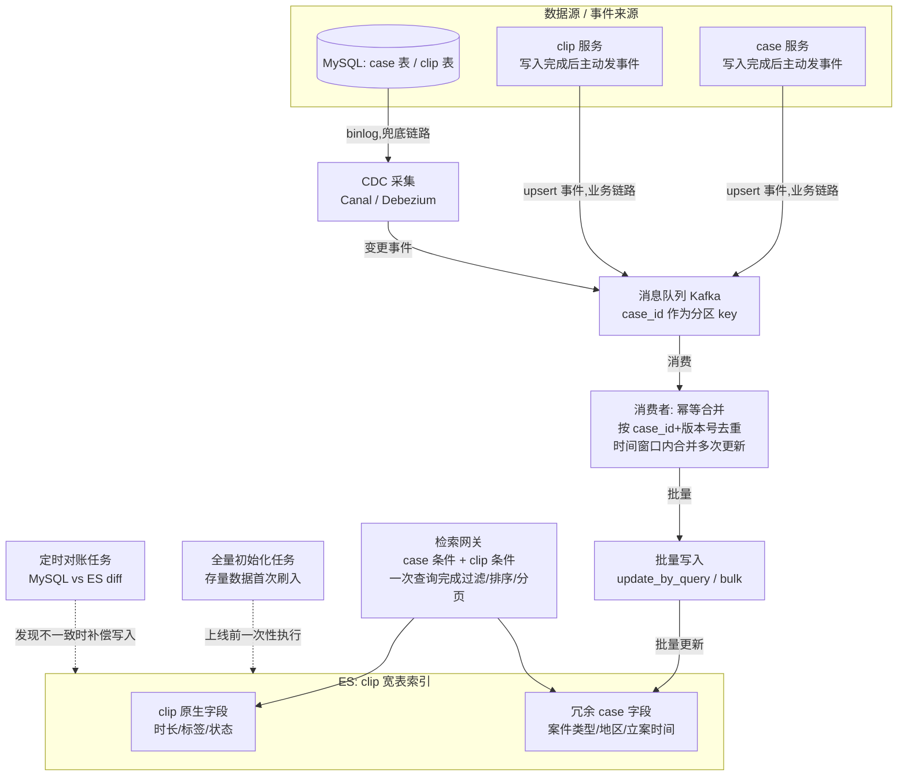

# Case-Clip 跨实体检索技术方案

## 1. 背景与问题

- **Case(案例)** 与 **Clip(视频片段)** 是一对多关系:一个 case 下有多个 clip
- 两个实体元数据分别存储在 **MySQL**(事务型主数据)和 **ES**(检索索引)中
- Clip 的 ES 文档中**只存储了 `case_id`**,case 的其他元数据(案件类型、地区、立案时间、状态等)均未冗余
- **需求**:支持用 case 的多条件组合(而非仅 case_id)去检索 clip

核心矛盾:ES 原生不支持跨 index 的 join 查询,而检索条件横跨了两个实体的数据边界。

---

## 2. 方案一:两阶段查询(应用层 Join)

### 2.1 核心思路

先用 case 的多条件查询 case 的 ES index,拿到满足条件的 `case_id` 集合;再用这批 `case_id` 作为过滤条件(`terms` query)去查询 clip 的 ES index。

### 2.2 架构流程图

### 2.3 关键实现要点

- `case_id` 集合较大时(如超过几千),需要用 `search_after` / PIT 分批拉取 case 结果,避免一次性 terms 过大
- clip 侧查询使用 `bool.filter + terms` 组合 clip 自身的检索条件
- 若需要按 case 字段排序或聚合,该方案处理起来较别扭,通常不建议在此场景使用

---

## 3. 方案二:数据冗余宽表(CDC 同步)

### 3.1 核心思路

将 case 中用于检索的关键字段,通过数据同步链路冗余进 clip 的 ES 文档,使 clip index 成为一张包含双方字段的"宽表",一次查询即可完成多条件混合过滤、排序、分页。

**双链路采集**:同步事件来源保留两条链路并存,互为补充:

1. **MySQL binlog CDC 链路**:兜底链路,保证不遗漏任何数据库层面的变更(包括绕过业务代码的直接改库、批处理脚本等),是数据一致性的最终保障
2. **业务层 upsert 事件链路**:case/clip 服务在完成写操作(insert/update)后,业务代码主动发一条 upsert 事件到 Kafka,链路更短、延迟更低,便于携带业务语义(如"本次是哪些字段变更"),减轻下游消费者的判断成本

两条链路的事件最终汇入同一个 Kafka topic(或分主题但消费者做合并),由消费者统一做**幂等**处理——以 `case_id + 版本号/更新时间戳` 判断新旧,后到的旧事件直接丢弃,避免两条链路乱序导致数据被脏写回退。

### 3.2 架构流程图

### 3.3 关键实现要点

- **不要全字段冗余**:只同步真正用于检索/过滤的 case 字段,其余字段保留在 case 侧按需二次查询
- **双链路职责划分**:业务 upsert 事件链路负责"快",binlog CDC 链路负责"全"(兜底补漏、防止业务代码遗漏发事件或发送失败);两条链路都写入同一 Kafka topic,由消费者统一处理,不建议在应用层分别维护两套同步逻辑
- **级联更新**:一个 case 更新需要批量更新其下所有 clip 文档,使用 `_update_by_query` + painless 脚本按 `case_id` 批量处理,避免逐条 update 打爆 ES
- **一致性兜底**:CDC 链路存在丢失/延迟风险,需增加定时对账任务(MySQL vs ES 字段 diff),发现不一致触发补偿更新
- **存量迁移**:上线前需一次性全量同步存量 case-clip 关系到宽表,建议分批 scroll + bulk 写入

### 3.4 重点:Case 元数据频繁更新的应对策略

⚠️ Case 的元数据在业务上可能被**频繁修改**(比如案件状态流转、多次修正案件信息),而每次 case 更新都需要级联更新其下所有关联的 clip 文档(可能是几十到上百条)。如果不做特殊处理,容易出现"写放大"问题——一次 case 更新被放大成大量 ES 写请求,压垮同步链路和 ES 集群,同时消息队列还可能出现同一 case 短时间内多条更新事件堆积、乱序的情况。需要重点设计以下几点:

- **同 case_id 事件合并(去抖动)**:消费者侧维护一个短时间窗口(如 1~3 秒)的本地聚合,同一 `case_id` 在窗口内的多次更新只取最后一次全量快照执行一次 ES 更新,避免同一 case 连续修改触发多次级联写入
- **Kafka 分区路由**:以 `case_id` 作为 Kafka 分区 key,保证同一 case 的事件在同一分区内保序消费,配合版本号/更新时间戳做幂等校验,避免乱序覆盖
- **限流与批量写入**:消费者对 ES 的写入做批量合并(bulk)与限流控制,避免瞬时热点 case(如某案件短时间内被多人反复编辑)打满 ES 写入线程池
- **只同步变更字段**:业务 upsert 事件建议携带"本次变更了哪些字段"的信息,消费者可判断是否命中被冗余的检索字段——若本次变更的字段都不在冗余字段清单内,则跳过本次 ES 同步,减少无效写入
- **降级开关**:为同步链路预留限流降级开关,极端情况下(如批量脚本刷库导致事件风暴)可临时丢弃非关键字段的同步事件,保证核心链路稳定,后续由定时对账任务补偿

---

## 4. 方案对比

| 对比维度 | 方案一:两阶段查询 | 方案二:数据冗余宽表 |
|---|---|---|
| 开发/改造成本 | 低,无需改动数据模型和同步链路 | 高,需建设 CDC 同步链路、消费者、对账机制 |
| 查询性能 | 中,两次网络往返,case 命中量大时 terms 查询开销上升 | 高,单次查询完成,无跨 index 依赖 |
| 支持 case+clip 混合排序/分页/聚合 | 差,处理复杂,体验不佳 | 好,原生支持任意组合 |
| Case 命中量敏感度 | 敏感,命中量越大(如上万)性能越差,需分批处理 | 不敏感,查询复杂度只取决于 clip 侧 |
| 数据一致性维护成本 | 无(实时查询,天然一致) | 有,需处理级联更新、CDC 延迟、定期对账 |
| Case 字段更新频率适应性 | 好,case 更新无需同步动作 | 需重点设计,依赖事件合并/去抖动/批量写入等机制应对频繁更新引发的写放大问题(详见 3.4) |
| 上线周期 | 快,可快速验证 | 慢,需要链路建设、全量迁移、灰度验证 |
| 适用场景 | case 命中量可控(几百~几千)、查询频率不高、开发资源紧张 | 高频核心检索功能、要求复杂混合条件、case 命中量常上万 |

### 4.1 选型建议

- **优先验证阶段 / 资源紧张**:先上方案一,快速满足需求,同时观察实际的 case 命中量分布
- **核心高频检索功能**:直接规划方案二,一次到位,避免后续二次重构
- **折中方案**:高频且稳定的 case 字段做冗余(方案二的轻量版),低频字段仍走两阶段查询兜底,平衡成本与体验

---

## 5. 后续实施步骤(方案二为例)

1. 梳理高频检索的 case 字段清单,确定宽表 mapping
2. 设计 CDC 链路:MySQL binlog → Canal/Debezium → Kafka → 消费者 → ES bulk/update_by_query
3. 存量数据全量迁移(分批 scroll + bulk)
4. 建立一致性校验与补偿机制(定时对账 + 告警)
5. 封装统一检索网关,自动组合 case + clip 条件构建 ES DSL
6. 监控同步延迟、失败重试、死信队列处理