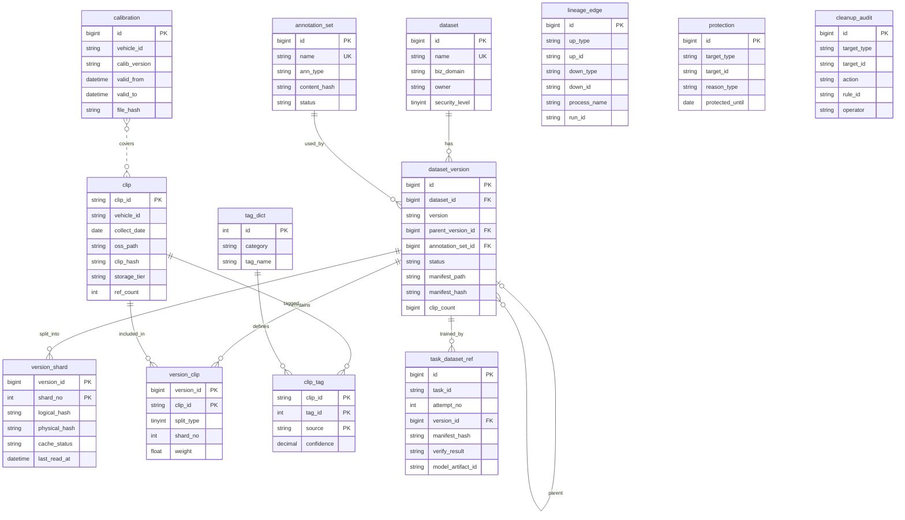

# 智驾数据集元数据 ER 图

| 项目 | 内容 |
|---|---|
| 文档版本 | V0.1（草案） |
| 编制日期 | 2026-10-13 |
| 配套文档 | 《智驾数据集元数据表设计》 |
| 渲染方式 | Mermaid `erDiagram`，可在支持 Mermaid 的 Markdown 工具中直接渲染（如 GitHub、GitLab、Typora、VS Code 插件、Mermaid Live Editor） |

> 说明：图中每张表只保留主键、外键、关键业务字段和哈希字段，完整字段以《智驾数据集元数据表设计》中的建表语句为准。

---

## 1 ER 图

---

## 2 图例与读图说明

| 符号 | 含义 |
|---|---|
| 实线 | 逻辑关联（设计中不建外键约束，引用完整性由应用层和巡检保证） |
| 虚线 | 非外键关联，通过业务字段间接对应 |
| `PK` / `FK` / `UK` | 主键 / 外键（逻辑）/ 唯一键 |
| `\|\|--o{` | 一对多 |
| `\|o--o{` | 零或一对多（用于自关联） |
| `}o..o{` | 多对多（间接） |

---

## 3 表间关系说明

| 关系 | 说明 |
|---|---|
| dataset → dataset_version | 一个数据集有多个版本 |
| dataset_version → dataset_version | 自关联，`parent_version_id` 指向父版本，用于版本演进追溯 |
| annotation_set → dataset_version | 版本通过 `annotation_set_id` 引用标注集；一个标注集可被多个版本使用 |
| dataset_version → version_shard | 一个版本由多个分片组成，分片记录逻辑哈希、物理哈希和缓存状态 |
| dataset_version ↔ clip | 通过关联表 `version_clip` 建立多对多关系，记录划分（train / val / test）、所属分片和采样权重；**这是最大的表，按 `version_id` 哈希分区** |
| clip → clip_tag ← tag_dict | clip 与场景标签的多对多关系，`source` 区分人工、规则、模型来源 |
| calibration ··· clip | 不是字段直连：通过 `vehicle_id` 加采集时间落入 `valid_from ~ valid_to` 区间来关联 |
| dataset_version → task_dataset_ref | 记录每个训练任务（含每次重试 `attempt_no`）使用的版本和启动校验结果 |

---

## 4 图中未连线的三张表

`lineage_edge`、`protection`、`cleanup_audit` 采用多态引用，通过 `target_type` + `target_id`（血缘表为 `up_*` / `down_*`）指向任意对象，可以是版本、clip、标注集、标定或模型。若逐一连线会让图变得难以阅读，因此单独列出。

| 表 | 引用方式 | 作用 |
|---|---|---|
| lineage_edge | `up_type/up_id` → `down_type/down_id` | 血缘边表，表达 raw → clip → annotation → version → model 的处理链路 |
| protection | `target_type/target_id` | 保护标记，清理程序必须跳过 |
| cleanup_audit | `target_type/target_id` | 清理审计，只追加不修改 |

**多态引用的可取值**

| 表 | 字段 | 可取值 |
|---|---|---|
| lineage_edge | `up_type` / `down_type` | raw、clip、annotation、version、model |
| protection | `target_type` | version、clip、annotation_set、calibration |
| cleanup_audit | `target_type` | version、clip、cache、object 等（按清理对象定义） |

---

## 5 渲染与使用提示

1. 如果工具不支持 Mermaid，可将第 1 节代码块内容粘贴到 Mermaid Live Editor 后导出 PNG / SVG。
2. 若需要更完整的字段，可在对应表的花括号内按建表语句补充；字段较多时建议拆成"核心表图"和"治理表图"两张。
3. Mermaid 的 `erDiagram` 不支持表示"无外键的逻辑关联"，图中用实线统一表示，读图时请以第 2 节图例为准。
